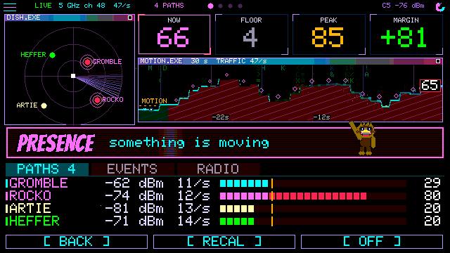
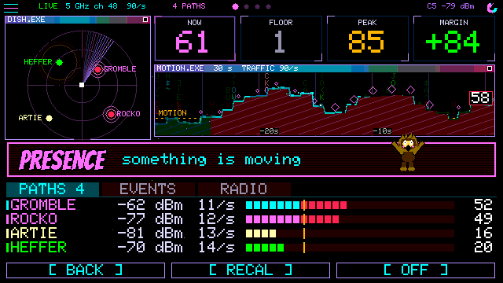
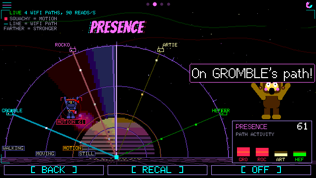
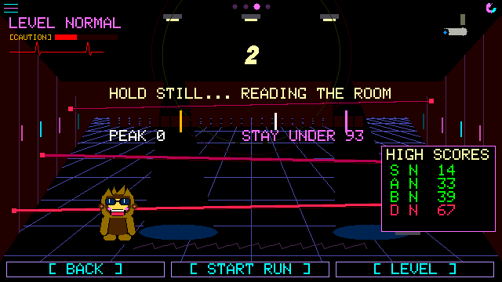
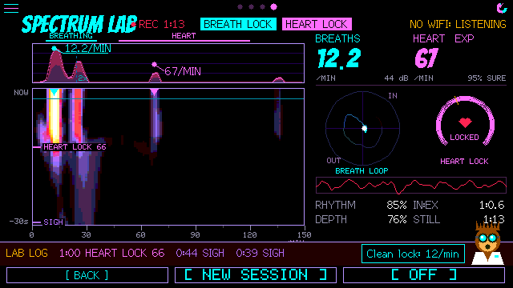

# Tab5 Monster C5 CSI Human Sensing

> Turn an M5Stack Tab5 and a C5Lab M5MonsterC5 into a WiFi motion sensor, a
> radar, a sneaking game and a breathing monitor. Beta.

<p align="center">
  
</p>

<p align="center">
  <b>No camera. No microphone. Nothing to wear.</b><br>
  Just the WiFi that's already bouncing around your room, and a Squachy who notices when it wobbles.
</p>

Every WiFi frame starts with a known pattern, so a radio can measure exactly
how it arrived across each of its sub-carriers (channel state information,
or CSI). In a still room that barely changes. Walk through it and your body
bends the reflections, and the CSI shakes. Sit still and even your breathing
moves it a little, in rhythm.

Seat C5Lab's **M5MonsterC5** on the M5Stack Tab5's long rear connector (the
M5-Bus, not Grove) and it becomes a listening-only sensing radio. It
calibrates on your still room for 30 seconds, scores every moment after
that from 0 to 100, and tells the Tab5 ten times a second. **It never joins
your network** and never needs your password: it only listens to traffic
that's already there.

This is a standalone spin-off of [SquachWatch](https://github.com/skizzophrenic/SquachWatch-CYD):
the same mascot and vaporwave look, but only the sensing. Nothing else from
SquachWatch is on the Tab5, and the Tab5's own radio (the C6) is never used.

## Four screens, a swipe apart

<table>
<tr>
<td width="50%" valign="top">

<br><b>SENSING</b>: the everyday screen. The score now, its floor, peak
and margin, a 30 second scrolling motion strip, every WiFi path it's
watching, and a log of what moved when.
</td>
<td width="50%" valign="top">

<br><b>SCOPE</b>: a radar with a spoke for each WiFi path. A spoke lights
up when something crosses that path, and Squachy calls out which one. It
shows which path moved, not where you're standing.
</td>
</tr>
<tr>
<td width="50%" valign="top">

<br><b>SNEAK</b>: a game. Squachy reads the room, then you have ten
seconds to cross it without the score going over the line. Pick EASY,
NORMAL or HARD, chase a clean run, and get graded on the high score table.
</td>
<td width="50%" valign="top">

<br><b>VITALS</b>: sit still about a metre away and the SPECTRUM LAB reads
your breathing: breaths a minute, rhythm, depth and breath holds. On the
bench it said 21 when a hand count said 21. The heart rate is
<b>experimental</b>, and none of this is a medical device.
</td>
</tr>
</table>

<sub>Every frame above is the firmware's own drawing code running in an
emulator, replaying a real walk-through recorded on the bench. The VITALS
clip is fed a simulated person sitting still, so its numbers are
illustrative. The clips were recorded before the bottom buttons were
renamed, so they show BACK and OFF where the Tab5 now says BRIGHT and
SLEEP.</sub>

**Along the bottom:** **BRIGHT** steps the screen down, all the way to
barely lit for filming in a dark room, then wraps back to full.
**RECAL** recalibrates (keep the room still for 30 seconds). **SLEEP**
turns the screen off until you touch it. On SNEAK the middle button is
START RUN and the right one picks the level; on VITALS the middle one
starts a NEW SESSION. The Tab5 remembers the brightness and the last
screen across a restart.

## What you need

- An **M5Stack Tab5**.
- A C5Lab **M5MonsterC5**, on the Tab5's **long rear connector (the M5-Bus)**.
- A busy WiFi network nearby, ideally **5 GHz**. Your own router is fine.
- A desktop computer with **Chrome or Edge** and USB-C cables that carry data.

## Install

Download the two files from the
[latest release](../../releases/latest) and flash each at address **0x0**
with Espressif's browser flasher,
[esptool-js](https://espressif.github.io/esptool-js/). The step-by-step,
including the Monster's BOOT/RESET dance and the way back to stock
firmware, is in **[docs/GUIDE.md](docs/GUIDE.md)**.

| File | Goes on |
|---|---|
| `tab5-csi-sensing-v1.0.0-beta.bin` | the Tab5 |
| `monster-c5-csi-radio-v1.0.0-beta.bin` | the M5MonsterC5 |

This replaces what's on both devices (the Tab5's current app and the
Monster's JanOS).

## On the bench

One house, a mesh of four access points on 5 GHz:

| | Measured |
|---|---|
| Readings | about **49 a second** on 5 GHz (about 1 a second on 2.4 GHz, which is why it prefers 5 GHz) |
| Empty room vs walking | median score **10** empty, **66** walking; **87 %** of the walking time read MOTION |
| Through one wall | partly: some movement next door shows, not all |
| 35 minute soak | **0** restarts, **0** bad lines, memory flat |
| VITALS breathing | **21** a minute on screen against **21** counted by hand (one run) |
| VITALS heart rate | **not verified** against a watch or monitor |

With one ordinary router you'll see fewer paths, but SENSING and SNEAK
work from just one. It's a beta, tested on one Tab5, one Monster and one
house, so reports from your room are very welcome.

## What it can't do

- **SCOPE shows which WiFi path moved, not where a person is.** No
  distance, no direction, no head count.
- **It doesn't know who or what moved.** A fan, a pet, a curtain or a robot
  vacuum moves the channel too. Calibrate with those still.
- **VITALS is not a medical device.** The heart rate is experimental and
  must not be relied on for anything.
- **It needs traffic.** A quiet 2.4 GHz-only network gives too few
  readings, and the screen says **LOW SIGNAL**. See the guide.

## Building it yourself

Two [PlatformIO](https://platformio.org/) environments on the
[pioarduino](https://github.com/pioarduino/platform-espressif32) platform
(the P4 and C5 need Arduino core 3):

```bash
pio run -e tab5          # the Tab5 app        -> .pio/build/tab5/firmware.factory.bin
pio run -e monster-c5    # the Monster's radio -> .pio/build/monster-c5/firmware.factory.bin
```

```
├── src/app/      the Tab5: main.cpp, the four screens (ui_sensing.cpp),
│                 VITALS' maths (vitals.cpp), the radio link (tab5_sense.cpp),
│                 the panel (tab5_*.cpp), Squachy (squachy.cpp), the theme
├── src/radio/    the Monster: CSI capture, the motion model, the chest signal
├── include/      headers; sense_proto.h is the line protocol between the two
├── tools/        bench loggers (sense_log.py, vitals_log.py) and the build's
│                 TFT_eSPI patch for the P4
├── test/         host test for VITALS' maths
└── docs/         the guide and the clips
```

The radio and the Tab5 talk plain ASCII at 115200 over the M5-Bus, so a
terminal on the Monster's own USB reads it too. Every line and command is
in [include/sense_proto.h](include/sense_proto.h).

## Credits

- The motion model is ported from
  [ESP32Marauder](https://github.com/justcallmekoko/ESP32Marauder)'s
  **CsiMotionModel** (MIT) by **justcallmekoko**, including its ESP32-C5
  recipe. See `src/radio/csi_motion_model.h`.
- [Evil-M5Project](https://github.com/7h30th3r0n3/Evil-M5Project)'s CSI Radar
  by **7h30th3r0n3** was the reference for second-transmitter sensing and
  breathing from CSI.
- The M5MonsterC5 and its stock firmware, JanOS, are C5Lab's. Their Tab5
  app showed which M5-Bus pins carry the link.
- Squachy and the look come from
  [SquachWatch](https://github.com/skizzophrenic/SquachWatch-CYD).

## License

GPL-3.0, see [LICENSE](LICENSE). The ported motion model keeps its MIT
notice in `src/radio/csi_motion_model.h`.
