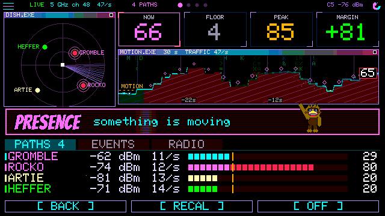

# Guide: Tab5 Monster C5 CSI Human Sensing (BETA)

  

## How it works, in one paragraph

Every WiFi frame carries a known training pattern at its start, so a receiver
can measure how each of the channel's sub-carriers arrived: how strong, how
delayed. That measurement is called channel state information (CSI). In a
still room it barely changes from one frame to the next. When something moves
between a transmitter and the receiver, the reflections change and so does
the CSI. The Monster learns what "still" looks like during a 30 second
calibration, then scores how far each new moment is from it, 0 to 100, for up
to four of the busiest transmitters it can hear, and fuses those into one
score. The Tab5 draws it.

## What you need

- An **M5Stack Tab5**.
- An **M5MonsterC5** (C5Lab), on the Tab5's **long rear connector (the
  M5-Bus)**. Not the Grove port: the radio talks to the Tab5 over the bus's
  UART pins (the Tab5's P4 pins 37/38, the C5's 11/12, 115200 8N1).
- A busy WiFi network nearby, ideally **5 GHz**. Your own router is fine:
  the radio only listens to the traffic that is already there. It does not
  join your network and it does not need your password.
- A desktop computer with **Chrome or Edge**, and USB-C cables that carry
  data.

## Installing

Two files from the release, both flashed at address **0x0** with Espressif's
browser flasher, [esptool-js](https://espressif.github.io/esptool-js/):

| File | Goes on |
|---|---|
| `tab5-csi-sensing-v1.0.0-beta.bin` | the Tab5 |
| `monster-c5-csi-radio-v1.0.0-beta.bin` | the M5MonsterC5 |

`SHA256SUMS.txt` beside them has their checksums.

**Before you start:** this replaces what is on both devices now: the Tab5's
current app, and the Monster's JanOS. Each image also clears that device's
saved settings. To go back later, reflash the Tab5 from M5Burner (M5Stack's
flashing tool) and the Monster from C5Lab's JanOS release.

### 1. The Tab5

1. Plug the Tab5 into the computer by USB-C. Use a port on the back of the
   PC if you can: on a front-panel port one Tab5 browned out.
2. Open [esptool-js](https://espressif.github.io/esptool-js/) in Chrome.
3. Under **Program**, press **Connect** and pick the Tab5's port.
4. Flash Address **0x0**, choose the Tab5 file, press **Program**.
5. When it finishes, press the Tab5's reset (or unplug it and plug it back in).

### 2. The Monster C5

The Monster has no automatic reset and cannot be flashed while it sits on the
Tab5 (the Tab5's UART shares its receive pin and drowns the USB adapter).

1. Take the Monster **off** the Tab5.
2. Plug the Monster's own USB-C into the computer.
3. Put it in download mode: **hold BOOT, tap RESET, let go of BOOT**. The
   buttons may be under the case.
4. Reload the esptool-js page, set the baud rate to **115200**, press
   **Connect** and pick the Monster's port (a CH340 serial port).
5. Flash Address **0x0**, choose the Monster file, press **Program**.
6. When it finishes, press the Monster's RESET once.

### 3. Together

1. Unplug the Monster's USB cable and seat the Monster on the Tab5's long
   rear connector. Leave the Monster's own USB-C unplugged while it is on the
   Tab5: a cable there can stop the Tab5's commands reaching it.
2. Turn the Tab5 on. It goes straight to the sensing screens.
3. **First start only:** the radio scans for a few seconds and settles on the
   loudest network's channel (5 GHz if it hears one, otherwise 2.4 GHz). It
   remembers it.
4. It calibrates for 30 seconds (**PLEASE STAND BY**). Keep the room still,
   or step out, until it finishes.
5. Swipe left or right for the four screens.

## The four screens

| Screen | What it shows |
|---|---|
| **SENSING** | The everyday screen: the state (STILL, POSSIBLE, MOTION, PRESENCE), the score now with its floor, peak and margin, a 30 second scrolling strip, each radio path, a log of movements, and the radio's channel and readings a second |
| **SCOPE** | A radar. Each transmitter the radio models is a spoke, and a spoke lights up when that path is disturbed. A spoke is a radio path, not a compass direction |
| **SNEAK** | A game. START RUN, hold still while Squachy reads the room, then cross it within ten seconds without the score going over the line. LEVEL picks EASY, NORMAL or HARD |
| **VITALS** | Sit still about a metre from the Tab5. After about 20 seconds it shows breaths a minute, rhythm, depth, holds and a breathing spectrum. A heart rate appears only when it is confident, and it is **experimental**. NEW SESSION restarts the clock |

The buttons along the bottom:

| Button | Does |
|---|---|
| **BRIGHT** | One step dimmer each tap: 75 %, 50 %, 25 %, 12.5 %, then halving down to about 0.4 %, then back to full. Remembered across a restart |
| **RECAL** | Calibrates again. Keep the room still for 30 seconds |
| **SLEEP** | Turns the screen off. Touch anywhere to wake it (that touch does nothing else) |

## Measured

Bench numbers from one house (2026-11-07 and 2026-11-08), on a mesh of four
access points sharing one 5 GHz channel. Your room, walls and router will
give different ones.

| | Measured |
|---|---|
| Readings, parked on 5 GHz channel 48 | about **49 a second**, from 4 mesh access points |
| Readings, parked on 2.4 GHz channel 11 | about **1 a second** (2.4 GHz beacons carry no CSI), which is why the radio prefers 5 GHz |
| Empty room vs walking | score median **10** empty, **66** walking; **87 %** of the walking time read MOTION |
| Sitting still at a desk | mostly POSSIBLE: presence yes, but not the same as walking |
| Through one wall | partly: some movement in the next room shows, not all |
| 35 minute soak, Tab5 + Monster | **0** restarts, **0** bad lines, a steady 10 reports a second, memory flat after the first 20 minutes |
| VITALS breathing | **21** breaths a minute on the screen against **21** counted by hand (one run, sitting still) |
| VITALS heart rate | **not verified** against a watch or monitor |

**With a single router you'll see fewer paths and fewer readings.** The radio
models the four busiest transmitters on its channel. That bench mesh filled
all four slots with access points that never go quiet. With one router you
get one steady path (the router), plus up to three more from your devices
(a phone, a laptop, a streaming TV) that come and go as they get busy. SCOPE
shows fewer spokes, and the PATHS list changes over time. That's normal:
SENSING and SNEAK work from one path. To add a steady path, keep a device
streaming on the same 5 GHz network.

## What it can't do

- **SCOPE shows which WiFi path moved, not where a person is.** The radio
  does not know where a transmitter is, so a lit spoke means "something
  disturbed the path to that transmitter", not "someone is over there". It
  gives no distance and no direction.
- **It doesn't know who or what moved, or how many.** A fan, a pet, a
  curtain in a draught or a robot vacuum moves the channel too. Calibrate
  with those still, or expect them to count.
- **VITALS is not a medical device.** It's a sensor demo. The breathing
  number matched a hand count on the bench. The heart rate is experimental,
  hasn't been checked against anything, and must not be relied on for
  anything. Nothing here diagnoses anything.
- **VITALS listens. It does not join WiFi.** The radio never joins a
  network on its own; every screen works from frames it overhears.
- **It needs traffic.** A quiet 2.4 GHz-only network gives too few readings,
  and the screen says **LOW SIGNAL** with the channel it is on. See below.

## LOW SIGNAL

The radio hears too few frames on its channel. Usually it's parked on
2.4 GHz, or the router it picked is far away or idle.

- Move the Tab5 nearer a busy access point, or start some traffic (a video
  playing on another device), then **RECAL**.
- Make it pick again: open a serial terminal on the **Tab5's** USB (Chrome:
  [Serial Terminal](https://googlechromelabs.github.io/serial-terminal/),
  115200) and type `park auto`; the Tab5 passes it on to the radio. Or
  `scan` to list the networks it hears and their channels, then
  `park <channel>` (for example `park 36`) to choose one yourself. The radio
  keeps the channel.

## For tinkerers

- **The line protocol** between the radio and the Tab5 is plain ASCII at
  115200, so a terminal on the Monster's own USB reads it too (take it off
  the Tab5 first). Every line and command is in
  [include/sense_proto.h](../include/sense_proto.h): `$S` status ten times a
  second, `$T` per path once a second, `$I` info, `$V` the chest signal
  during VITALS, and commands such as `park`, `scan`, `cal`, `caltime`,
  `hold`, `rates` and `info`.
- **The Tab5's console** (its USB, 115200) passes any line straight to the
  radio, and `pass [s]` makes the Tab5 let go of the M5-Bus for that many
  seconds (90 by default), so the Monster can be reached on its own USB
  without lifting it off. Lifting it off is still the reliable way.
- **VITALS with a network:** the radio can lend itself to a network for a
  steadier chest signal (`vitalsnet <ssid><TAB><password>` on the Monster's
  own USB, or `tools/vitals_wifi.py`, which asks for the password without
  echoing it). On the bench it worked better listening, so that is the
  default; `vitalsnet forget` clears it.
- **Bench logs:** `tools/sense_log.py` and `tools/vitals_log.py` record and
  summarise the radio's lines.
- **Building:** `pio run -e tab5` and `pio run -e monster-c5`, both on the
  pioarduino platform pinned in `platformio.ini`.

## Credits

- The motion model is ported from
  [ESP32Marauder](https://github.com/justcallmekoko/ESP32Marauder)'s
  **CsiMotionModel** (MIT) by **justcallmekoko**, including its ESP32-C5
  recipe. See `src/radio/csi_motion_model.h`.
- [Evil-M5Project](https://github.com/7h30th3r0n3/Evil-M5Project)'s CSI Radar
  by **7h30th3r0n3** was the reference for using a second transmitter and
  for breathing from CSI. Here any busy transmitter is modelled, so there is
  no beacon to pair.
- The M5MonsterC5 and its stock firmware, JanOS, are C5Lab's. Their Tab5
  app showed which M5-Bus pins carry the link, and this uses the same ones.
- Squachy and the look come from
  [SquachWatch](https://github.com/skizzophrenic/SquachWatch-CYD).
